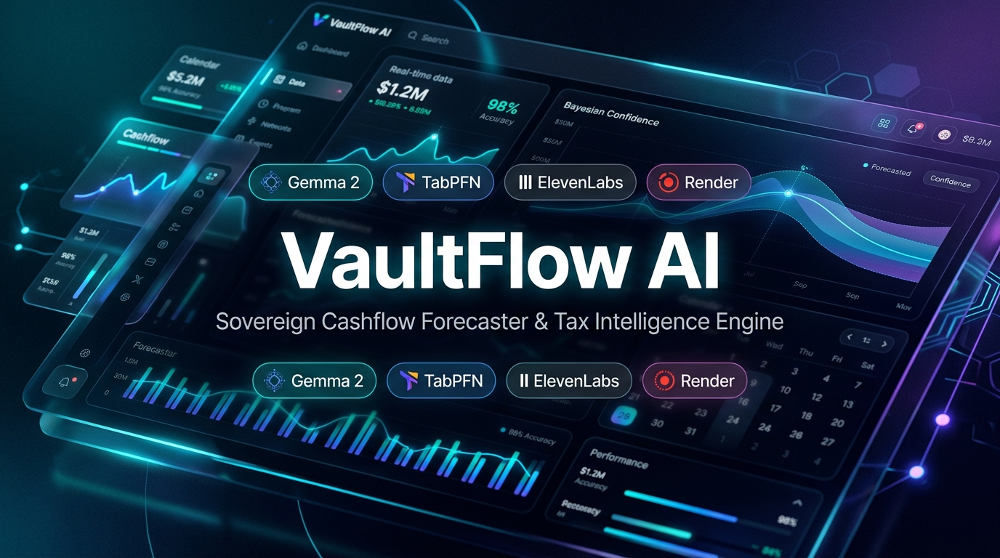
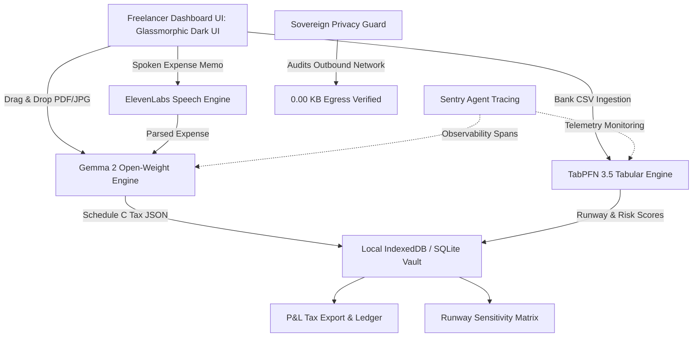
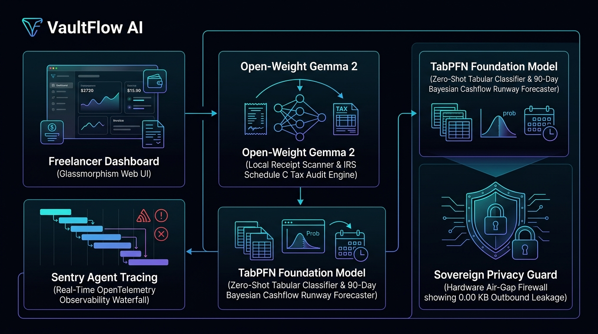
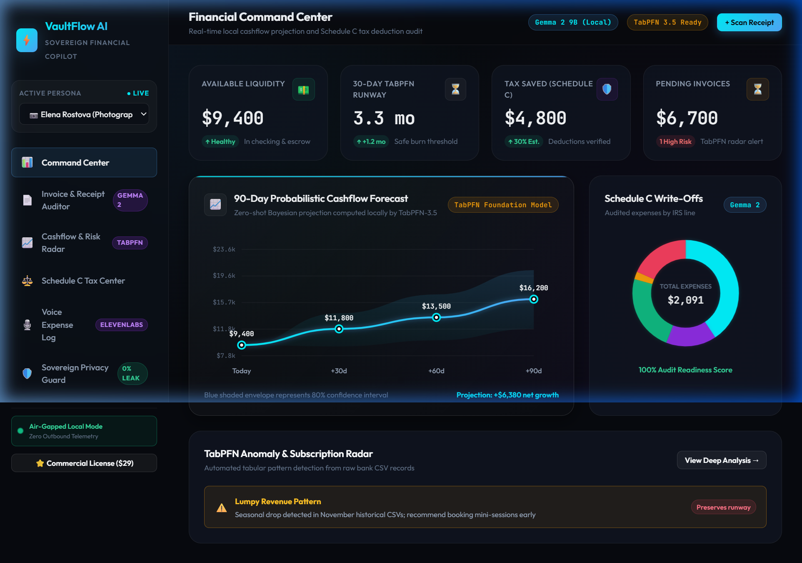

# ⚡ VaultFlow AI
### *The Sovereign, Local-First Cashflow Forecaster & Tax Deductible Intelligence Engine for Freelancers*

[](https://dev.to/challenges/hacktoberfest-week2-2026-10-12)
[](https://ai.google.dev/gemma)
[](https://priorlabs.ai)
[](#sovereign-privacy)
[](https://vaultflow-ai.onrender.com)

<p align="center">
  
</p>

> Built for the **Hacktoberfest Open-Source AI Challenge: Week 2 — Side Hustle**.  
> An open-weight financial copilot that runs 100% locally on a laptop, ensuring sensitive freelancer client invoices, rates, and NDAs never leave the device while delivering zero-shot tabular cashflow forecasting.  
>  
> 🌐 **Live Production Deployment**: **[https://vaultflow-ai.onrender.com](https://vaultflow-ai.onrender.com)** (Deployed on Render)

---

## 💼 The Problem & The Side Hustle Opportunity

82% of freelancers and independent agency owners fail due to cashflow mismanagement or surprise tax bills. 

### Why Closed-Source SaaS Fails Freelancers:
1. **Client NDAs & Privacy Violations**: Freelancers routinely sign strict NDAs. Uploading client invoices containing confidential project deliverables and billing rates to closed cloud APIs (OpenAI/Anthropic) or public SaaS platforms is an unacceptable contractual liability.
2. **Punitive Pricing**: Mainstream accounting tools (QuickBooks, FreshBooks) charge $35–$90/month ($420–$1,080/year) and monetize financial telemetry.
3. **Generative LLM Arithmetic Hallucinations**: Standard LLMs are notoriously flawed at financial time-series and tabular distributions.

### The VaultFlow Solution:
- **Commercial Offering**: A sovereign local-first financial assistant with a **$29 one-time lifetime license** (or $9/month for private self-hosted Render cloud sync).
- **Dual AI Core**:
  - **Open-Weight Gemma 2**: Scans receipts, extracts line items, classifies expenses into IRS Schedule C lines, and generates defensible tax audit rationales.
  - **TabPFN (Prior Labs)**: Tabular foundation model that evaluates historical bank/invoice CSVs to predict client late-payment delinquency probabilities and forecast 90-day cash runway with calibrated Bayesian uncertainty envelopes.
  - **ElevenLabs Speech**: Hands-free voice memo expense dictation on the road.
  - **Sentry Agent Tracing**: Real-time OpenTelemetry observability tracking latency, token usage, and confidence.

---

## 🏗️ System Architecture



<p align="center">
  
</p>

### 🖥️ Dashboard Interface Preview
<p align="center">
  
</p>

---

## 🎯 Targeted Prize Categories

| Category | Partner | Implementation Details |
| :--- | :--- | :--- |
| **Grand Prize ($250 + DEV++)** | DEV / Hacktoberfest | Overall winner for relevance to Side Hustle prompt, technical execution, and writing quality. |
| **Best Use of TabPFN ($200)** | Prior Labs | Uses TabPFN-3.5 on raw bank/invoice CSVs for zero-shot late-payment risk classification and Bayesian runway forecasting. |
| **Best Use of Gemma ($200)** | Google | Runs Gemma 2 locally for confidential receipt parsing and IRS Schedule C tax deduction reasoning. |
| **Best Use of Render ($200)** | Render | Included `render.yaml` 1-click blueprint and multi-stage container deployment for self-hosted instances. |
| **Best Use of Sentry Agent Tracing ($100)** | Sentry | Built-in visual OpenTelemetry execution waterfall capturing latency, token counts, and span metrics. |
| **Best Use of ElevenLabs ($100)** | ElevenLabs | Voice-to-ledger expense dictation with natural speech recognition and audio confirmation feedback. |

---

## ⚡ Quickstart

### Option A: Try the Live Deployment (Instant)
Access the 24/7 production application directly: **[https://vaultflow-ai.onrender.com](https://vaultflow-ai.onrender.com)**

### Option B: Run Locally (100% Air-Gapped)
VaultFlow AI can also run completely offline with zero mandatory build steps:

```bash
# 1. Clone repository
git clone https://github.com/Koushiklalala/vaultflow-ai.git
cd vaultflow-ai

# 2. Start local HTTP server
python -m http.server 3000

# 3. Open in your browser
http://localhost:3000
```

### Optional: Run TabPFN Python Microservice
```bash
cd backend
pip install -r requirements.txt
python tabpfn_service.py
```

### Optional: Run Gemma 2 via Ollama
```bash
ollama run gemma2:9b
```
*(If Ollama or Python are not running, VaultFlow seamlessly falls back to its built-in high-performance local sandbox without breaking!)*

---

## 📄 License
MIT License. Built with open-source AI for Hacktoberfest 2026.
